# ConstruTrack · Gestión de personal por proyecto

[](https://github.com/diavolo34/Proyecto-Poo/actions/workflows/ci.yml)


[](https://construtrackfm.netlify.app)

> **Pruébalo en línea:** https://construtrackfm.netlify.app. La versión publicada está **lista para clientes**: arranca
> vacía y cada constructora crea su empresa al registrarse como gerente. Para verla con datos de ejemplo, usa el
> [modo demostración](#modo-demostración).
> El servidor usa el plan gratuito de Render: si nadie lo usó en un rato, la primera carga tarda unos 50 segundos.

Sistema para empresas de construcción que **controla la asistencia verificable del personal de cada proyecto, lo organiza en
áreas con su supervisor, gestiona sus permisos y reposos médicos, los reportes de proyecto, el inventario de herramientas
y los egresos (talento humano), y apoya al
supervisor y al gerente con alertas automáticas, estadísticas y reportes**.
Tiene **dos vistas sobre el mismo modelo**: una aplicación de escritorio (Swing) y una aplicación web.

Proyecto de **Programación Orientada a Objetos** (UCAB). Backend en **Java puro, sin librerías externas**, diseñado con
herencia, polimorfismo, interfaces, composición y los principios **SOLID**, en una arquitectura **MVC por capas**.


## Contenido

- [Funcionalidades](#funcionalidades)
- [Arquitectura](#arquitectura)
- [Cómo ejecutarlo](#cómo-ejecutarlo)
- [Modo demostración](#modo-demostración)
- [Capturas](#capturas)
- [Documentación](#documentación)
- [API REST](#api-rest)
- [Calidad](#calidad)

## Funcionalidades

| Rol | Qué puede hacer |
|-----|-----------------|
| **Visitante** | Ver la portada, consultar a **Arqui**, el asistente virtual, y **crear su cuenta** con correo, nombre, apellido, cédula o DNI y teléfono, eligiendo **«Soy gerente: crear mi empresa»** o **«Me uno a una empresa»**. |
| **Empleado** | Unirse a la empresa con un **código de registro**, marcar entrada y salida **con su ubicación** (y el QR del proyecto si se exige), ver su historial, sus **días sin marcar**, sus **permisos y reposos** y las **herramientas a su cargo**. |
| **Supervisor** | Todo lo anterior + **registrar permisos laborales, reposos médicos y reportes de proyecto** de su personal, **sumar a su área a quien no tiene una**, **confirmar marcas dudosas viendo el mapa**, aprobar horas extra, **iniciar y concluir proyectos** y **reportar retrasos**, alertas, tabla de puntualidad y reportes en CSV o texto. |
| **Gerente** | **Crea su empresa** al registrarse. **Aprueba o rechaza con nota** permisos, reposos y reportes de proyecto (queda como autorizador), recibe las **alertas de retraso** y de herramientas sin devolver, gestiona al **personal**, las **áreas** con su supervisor, el **catálogo de puestos**, el **inventario**, **Talento humano** (despidos y renuncias) y el **registro de personal**. |

Reglas destacadas:
- **Permisos y reposos:** los registra el supervisor y quedan pendientes hasta que el gerente los aprueba o rechaza con una
  **nota obligatoria**. El reposo médico exige médico, matrícula, centro asistencial, tipo de consulta (interna o por
  emergencia) y la **foto o PDF del reposo**, que se guarda en **Google Drive**.
- **Incapacidad:** un reposo aprobado justifica esos días como «Incapacidad» y **bloquea la marca** mientras dure; faltar
  **dos días laborables seguidos** sin justificar genera una alerta alta.
- **Reportes de proyecto** (retardo, inasistencia, accidente laboral): solo para supervisores y gerente; el empleado no los ve.
- **Áreas** (plomería, electricidad, transporte…): cada una tiene **un supervisor responsable** y cada persona pertenece
  a una sola. **El área manda:** al entrar a un área, el empleado queda a cargo de su supervisor, y si el área cambia de
  supervisor, cambia para todos. El gerente crea, elimina y mueve; el supervisor solo suma a su área a quien no tiene una.
- **Proyectos:** Planificado → En curso («Inicio del proyecto») → Concluido («Conclusión del proyecto»). Los nuevos se
  numeran PR-01, PR-02… (los antiguos conservan su código OB-). El supervisor reporta
  **retrasos** con motivo y nueva fecha estimada, y el gerente recibe la alerta hasta marcarlo como revisado.
- **Talento humano:** el egreso (despido o renuncia) exige el **voucher de pago**, la **carta de renuncia** si aplica y si
  **devolvió o no los equipos** (con nota de lo que falta). La persona queda **inactiva**: no entra ni aparece en el
  personal, y su historial se conserva. «Eliminar ficha» libera su cédula y guarda un **expediente** descargable.
- **Inventario:** herramientas, equipos y materiales con código, serie y cantidad; entregas por persona y proyecto con fecha de
  devolución; la devolución registra si llegó en buen estado, con daños (pasa a mantenimiento) o extraviado.
- **Asistencia comprobable:** cada entrada guarda la **ubicación**; sin ubicación, o lejos del proyecto, o sin el **código QR
  que cambia cada 30 segundos**, la marca queda **por confirmar** y el supervisor la revisa en el mapa.
- **Varias empresas**: cada gerente crea la suya y solo ve sus datos. Los empleados y supervisores entran con el **código
  de registro** que les da su gerente (con rol, puesto y proyecto). Los códigos vencidos o cancelados **se borran solos**.
- **Seguridad:** correo verificado, **verificación en dos pasos** para el gerente, claves con **PBKDF2**, bloqueo tras 5
  intentos, recuperación de clave por correo, sesiones de 12 h, cabeceras de seguridad y **ojo para mostrar la clave**.
  Detalles en [docs/seguridad.md](docs/seguridad.md).
- Las **horas extra** se calculan solas y solo cuentan al aprobarse; la hora es la de Venezuela aunque el servidor esté en UTC.

## Arquitectura

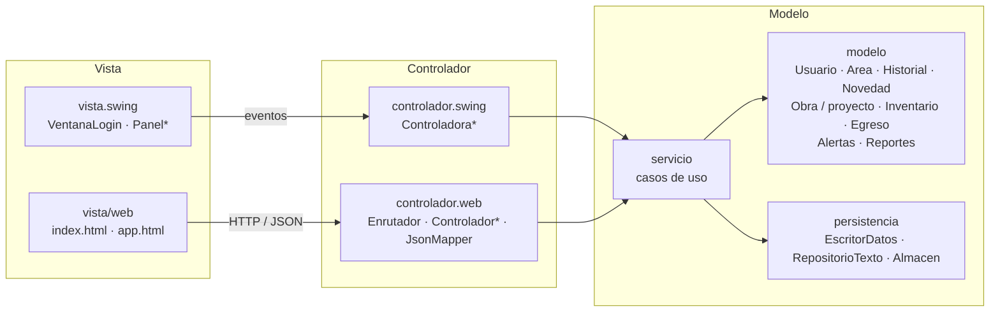

- **Modelo** sin dependencias de la vista: las dos interfaces reutilizan exactamente las mismas reglas. Ver [docs/diseno/mvc.md](docs/diseno/mvc.md).
- **SOLID** con ejemplos reales y su antes/después: [docs/diseno/solid.md](docs/diseno/solid.md).
- **UX/UI**: las 10 heurísticas de Nielsen, leyes de Hick, Gestalt y Von Restorff, y WCAG con contrastes medidos: [docs/diseno/ux-ui.md](docs/diseno/ux-ui.md).

<p align="center"></p>

## Cómo ejecutarlo

### Con NetBeans (recomendado)

1. `File → Open Project…` → carpeta **`ConstruTrack`**.
2. **Run** (F6): se abre la **ventana de escritorio** y el **servidor web** queda en http://localhost:8080
   (portada en `/`, sistema en `/app.html`). No hace falta internet.

Requisitos: JDK 17 o superior. Para correr las pruebas (*Test Project*), agrega la biblioteca JUnit 5 que trae NetBeans.

### Desde la terminal

```bash
javac --release 17 -encoding UTF-8 -d out $(find ConstruTrack/src -name "*.java")
(cd ConstruTrack/src && find . -type f ! -name "*.java" -exec cp --parents {} ../../out/ \;)
java -cp out construtrack.App            # servidor + ventana (usa --sin-ventana para solo el servidor)
```

### En internet

| Parte | Dirección |
|-------|-----------|
| Página web (Netlify) | https://construtrackfm.netlify.app |
| Servidor Java / API (Render) | https://construtrack-api.onrender.com/api/estado |

El servidor Java se publica en **Render** (`Dockerfile` + `render.yaml`) a partir de `main`.
La página se sirve desde **Netlify** (`netlify.toml`). Pasos en [docs/despliegue.md](docs/despliegue.md).

## Modo demostración

Por defecto ConstruTrack arranca **vacío (modo producción)**: no existen usuarios de prueba y el primer cliente se registra
como gerente y crea su empresa. Para presentaciones hay dos formas de ver el sistema con datos de ejemplo:

- **En local (NetBeans o terminal):** arranca con el argumento `--demo` (en NetBeans: *Project Properties → Run →
  Arguments* → `--demo`) o con la variable `DEMO=true`. Se crea la empresa «Constructora Demo» con los usuarios de abajo.
- **Demo privada en la página publicada:** con la variable `DEMO_CLAVE` en Render, se abre
  `https://construtrackfm.netlify.app/app.html#demo`, se escribe la clave y se elige entrar como Gerente, Supervisor o
  Empleado. Es una empresa de prueba **separada de los clientes**, en memoria (se reinicia con el servidor), que no envía
  correos reales ni aparece en las cifras de la portada. Sin la clave no se puede entrar.

Usuarios del modo demostración:

| Rol | Correo | Cédula | Clave |
|-----|--------|--------|-------|
| Gerente | `carlos.mendez@construtrack.demo` | `10000001` | `gerente123` |
| Supervisora | `ana.rodriguez@construtrack.demo` | `20000001` | `super123` |
| Supervisor | `luis.perez@construtrack.demo` | `20000002` | `super123` |
| Empleado | `jose.garcia@construtrack.demo` (+5 más) | `30000001` … `30000006` | `emp123` |
| Registrada sin empresa | `rosa.gutierrez@correo.com` | — | `rosa1234` |

Código de registro de prueba: **`CT-RQ7K-4M2P`** (Empleado, proyecto Torre Residencial Este). Áreas de ejemplo:
Plomería y Electricidad (Ana), Mantenimiento y Transporte (Luis).
Para volver a empezar en local, borra `datos_construtrack.txt` y reinicia (vacío, o con los datos de ejemplo si usas `--demo`).

## Capturas

| Permisos y reposos (el gerente aprueba con nota) | Panel de control |
|---|---|
| 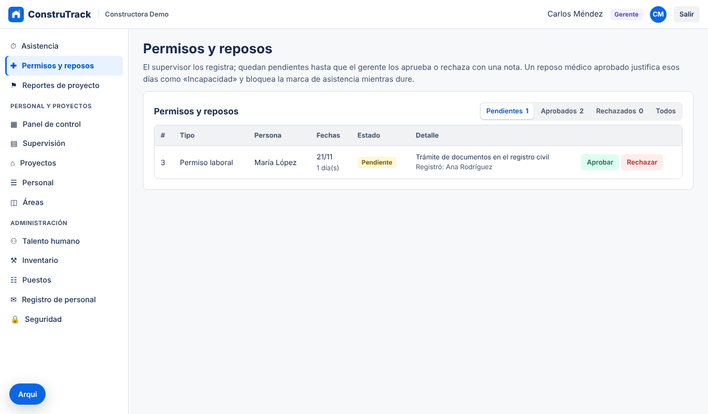 | 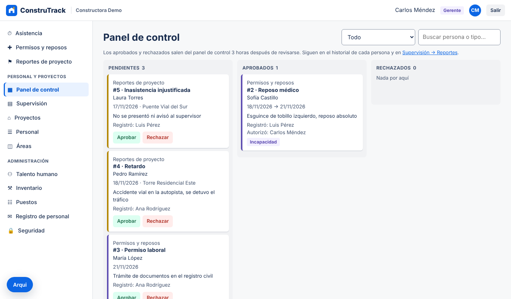 |
| **Áreas con su supervisor** | **Escritorio (Swing): áreas** |
| 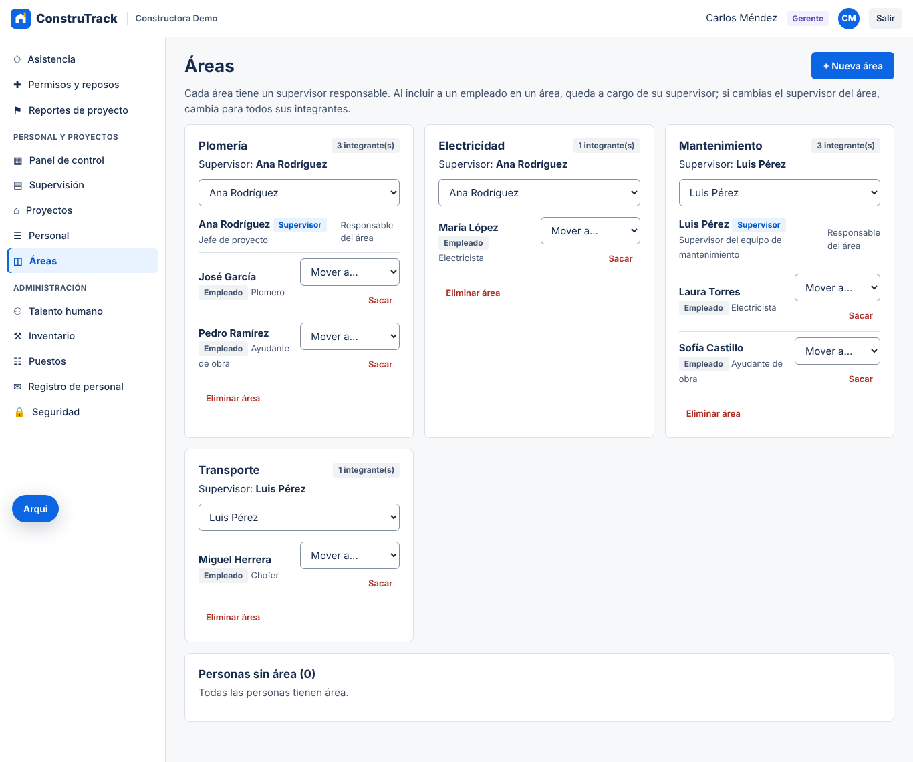 | 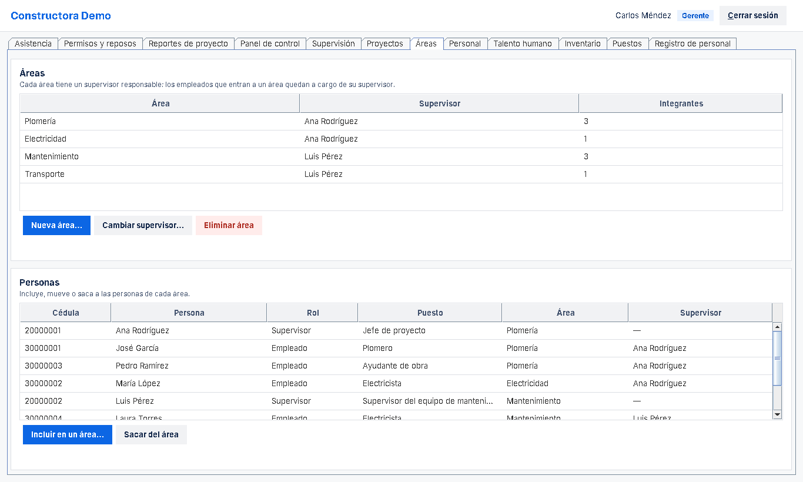 |
| **Registrar un reposo médico (supervisor)** | **Dónde marcó cada persona (mapa)** |
| 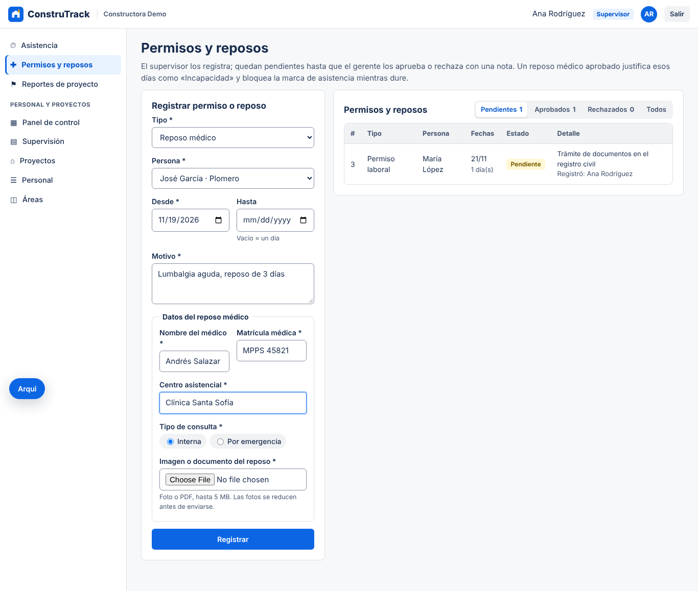 | 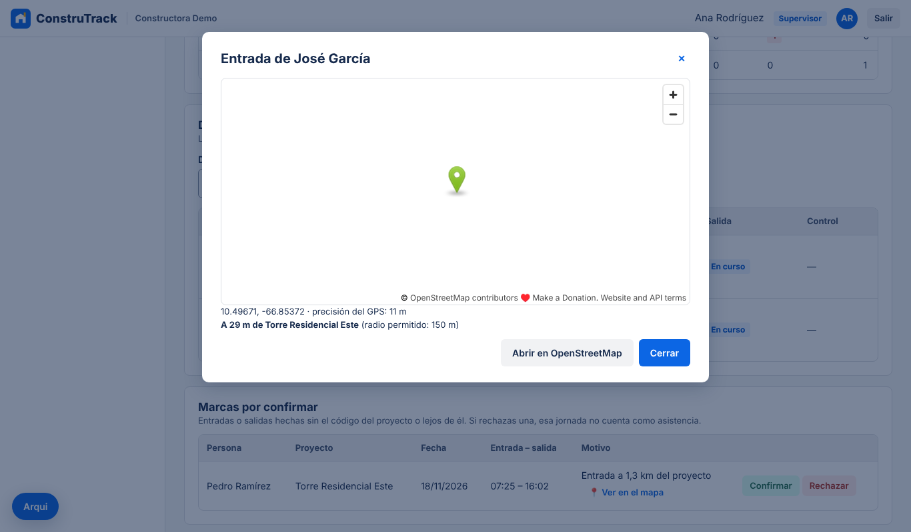 |
| **Talento humano** | **Inventario** |
| 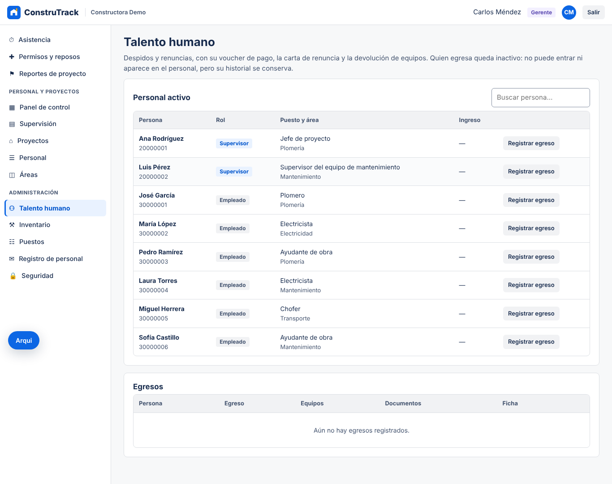 | 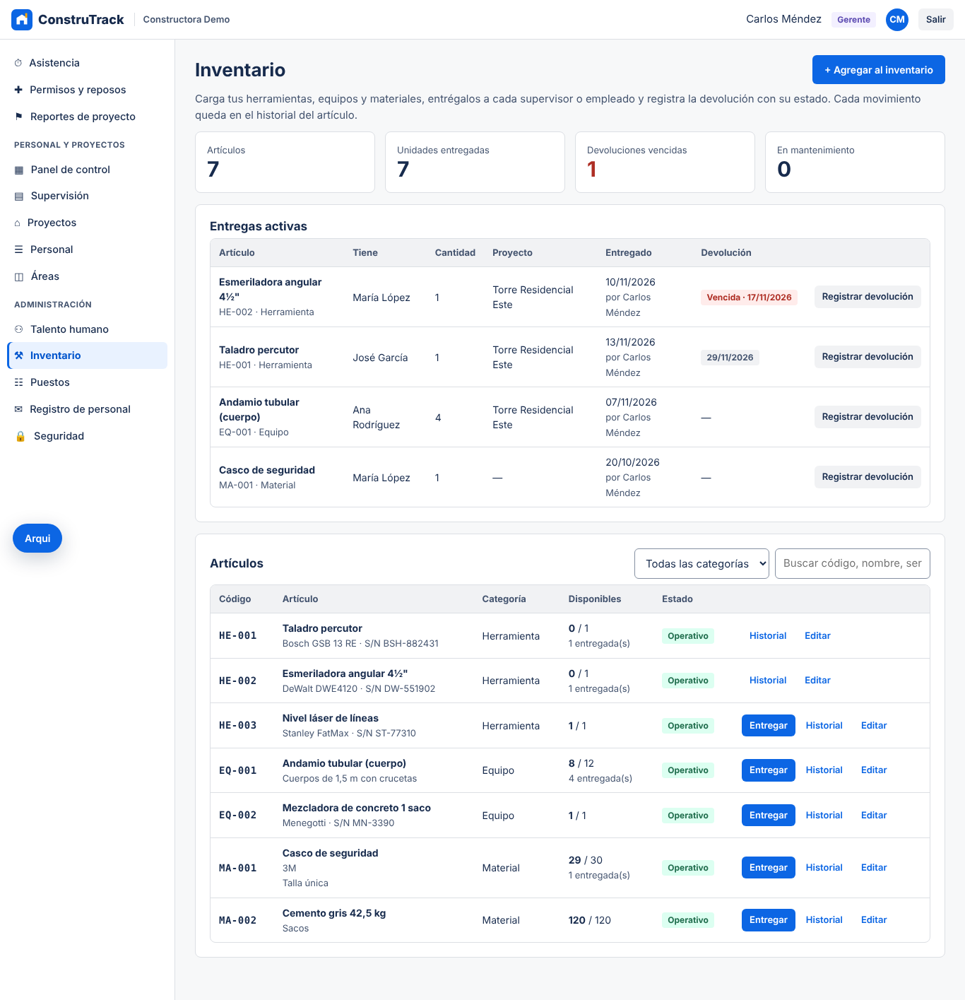 |
| **Proyectos: inicio, conclusión y retrasos** | **Escritorio (Swing): permisos y reposos** |
| 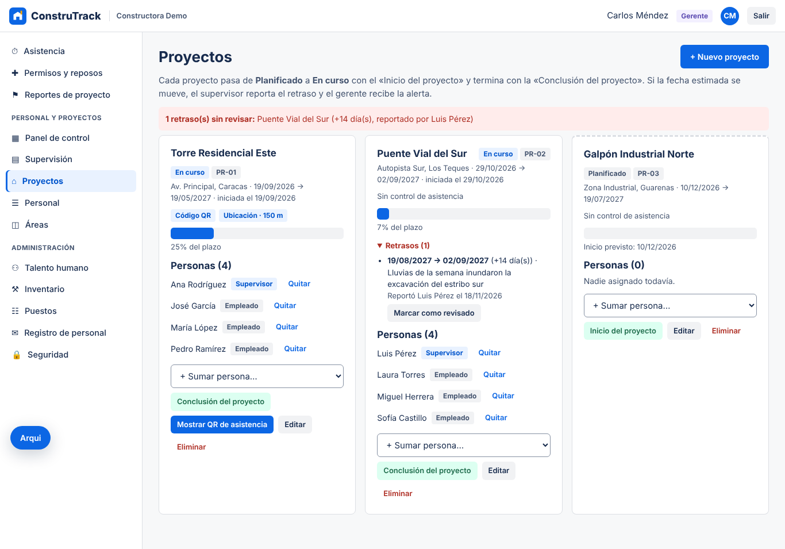 | 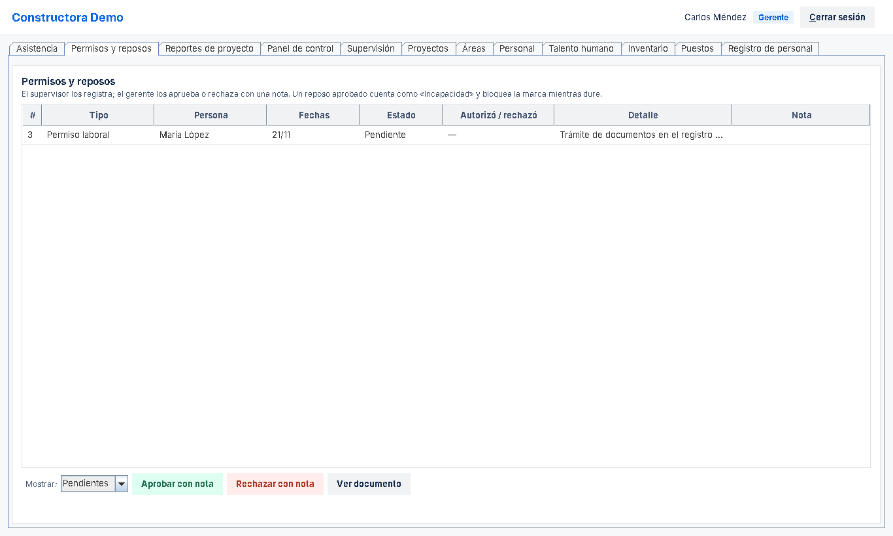 |

Más capturas en [docs/capturas](docs/capturas).

## Documentación

| Tema | Documento |
|------|-----------|
| Arquitectura MVC | [docs/diseno/mvc.md](docs/diseno/mvc.md) |
| Principios SOLID | [docs/diseno/solid.md](docs/diseno/solid.md) |
| Principios UX/UI | [docs/diseno/ux-ui.md](docs/diseno/ux-ui.md) |
| Diagramas UML (casos de uso, clases, paquetes, secuencia) | [docs/diagramas](docs/diagramas) |
| Scrum: backlog y sprints | [docs/scrum](docs/scrum) |
| Despliegue (Render + Netlify) | [docs/despliegue.md](docs/despliegue.md) |
| Seguridad: medidas, cookies, lista de verificación e ideas de asistencia comprobable | [docs/seguridad.md](docs/seguridad.md) |
| Herramienta de IA y prompts | [docs/prompts.md](docs/prompts.md) |

## API REST

Autenticación con la cabecera `Authorization: Bearer <token>`; respuestas en JSON y errores como `{"error": "mensaje"}`
con códigos 400, 401, 403, 404, 409 o 429 (demasiados intentos).

| Método | Ruta | Acceso |
|--------|------|--------|
| `GET` | `/api/estado` · `/api/publico` | Público |
| `POST` | `/api/login` (correo o cédula) · `/api/registro` | Público |
| `POST` | `/api/clave/olvido` (envía el enlace) · `/api/clave/restablecer` | Público |
| `POST` | `/api/verificacion` (código del correo) · `/api/verificacion/reenviar` | Cuenta registrada |
| `POST` | `/api/login/dos-pasos` (código de la aplicación) | Público, con el desafío del login |
| `GET` `POST` | `/api/dos-pasos` · `/api/dos-pasos/iniciar` · `/activar` · `/desactivar` | Gerente |
| `GET` `PUT` | `/api/asistencia/por-confirmar` · `/api/asistencia/{cedula}/{fecha}/verificacion` | Supervisor (su personal) · Gerente |
| `GET` | `/api/obras/{codigo}/codigo-asistencia` (código QR vigente del proyecto) | Supervisor · Gerente |
| `POST` | `/api/unirse` · `/api/empresas` (crear la empresa y quedar como Gerente) | Cuenta registrada |
| `POST` | `/api/logout` · `GET /api/yo` | Con sesión |
| `POST` | `/api/asistencia/entrada` · `/api/asistencia/salida` | Con sesión |
| `GET` `POST` | `/api/novedades?categoria=LICENCIA\|REPORTE_OBRA` · `GET /api/novedades/opciones` | Con sesión (el empleado solo ve sus permisos; registra el supervisor) |
| `PUT` | `/api/novedades/{id}/revision` (`{estado, nota}`) | Gerente |
| `POST` `GET` | `/api/archivos` (foto o PDF en base64, hasta 5 MB) · `/api/archivos/{id}` | Supervisor · Gerente (y la persona, si no es confidencial) |
| `GET` | `/api/asistencia/ubicaciones?fecha=` (dónde marcó cada persona) | Supervisor (su personal) · Gerente |
| `POST` `PUT` | `/api/obras/{codigo}/inicio` · `/conclusion` · `/retrasos` · `/retrasos/{id}/revision` | Supervisor (retraso) · Gerente (revisión) |
| `GET` `POST` | `/api/talento` · `/api/talento/pendientes/{cedula}` · `/api/talento/egresos/{cedula}` · `/egresos/{id}/eliminar-ficha` · `/egresos/{id}/expediente` | Gerente |
| `GET` `POST` `PUT` `DELETE` | `/api/inventario[/{codigo}]` · `/api/inventario/{codigo}/entregas` · `/api/inventario/entregas/{id}/devolucion` · `GET /api/inventario/a-cargo/{cedula}` | Gerente (a cargo: la persona y su supervisor) |
| `GET` `POST` | `/api/catalogo` · `/api/catalogo/puestos` · `/api/catalogo/puestos/quitar` | Gerente (lectura: todos) |
| `GET` `POST` | `/api/areas` · `/api/areas/supervisor` · `/api/areas/eliminar` · `/api/areas/incluir` · `/api/areas/sacar` | Gerente · Supervisor (ve sus áreas e incluye a personas sin área) |
| `GET` | `/api/estadisticas` · `/api/supervision/alertas` · `/api/reportes/{tipo}` | Supervisor (su personal) · Gerente |
| `GET` `POST` `PUT` | `/api/usuarios[/{cedula}]` · `GET /api/personal/opciones` | Gerente (Supervisor: solo lectura de su personal) |
| `GET` `PUT` | `/api/horas-extra` · `/api/horas-extra/{cedula}/{fecha}` | Supervisor (su personal) · Gerente |
| `GET` `POST` `PUT` `DELETE` | `/api/obras[/{codigo}]` (proyectos) · `PUT /api/usuarios/{cedula}/obra` | Supervisor · Gerente |
| `GET` `POST` `DELETE` | `/api/invitaciones[/{codigo}]` (códigos de registro) · `POST /api/invitaciones/{codigo}/enviar` | Gerente |

## Calidad

- **CI en GitHub Actions:** compila con `-Xlint:all -Werror`, ejecuta las **112 pruebas JUnit 5** y pruebas de humo de la API (incluidos permisos, inventario, talento humano, catálogo, áreas y proyectos) en modo demostración, en modo producción y de la demo privada (incluye cabeceras de seguridad, recuperación de clave y bloqueo por intentos).
- **Pruebas** del modelo, la persistencia y los servicios con reloj fijo; se comprobó que detectan errores introducidos a propósito.
- Verificado en la interfaz real: recorridos de la web con Playwright, de Swing en pantalla virtual, y despliegue con Docker y CORS.

## Estructura del repositorio

```
ConstruTrack/                 Proyecto NetBeans (Ant)
  src/construtrack/
    App.java                  Punto de entrada (composición de dependencias)
    modelo/                   Dominio: usuarios, historial, novedades, talento, inventario, alertas, reportes
    servicio/                 Casos de uso
    persistencia/             Repositorios y datos de prueba
    controlador/swing|web/    Controladores de cada vista
    vista/swing/              Ventanas y paneles Swing
    vista/web/                Portada, aplicación web, CSS y JavaScript
  test/construtrack/          Pruebas JUnit 5
docs/                         Diseño, UML, Scrum, capturas, despliegue
tools/generador/              Genera las capturas y el PDF de entrega
tools/correo-gmail/           Google Apps Script: correos desde Gmail y documentos en Drive
Dockerfile · render.yaml · netlify.toml
```

## Autor

**Francisco Manzano** · [@diavolo34](https://github.com/diavolo34) · Universidad Católica Andrés Bello · Programación Orientada a Objetos
