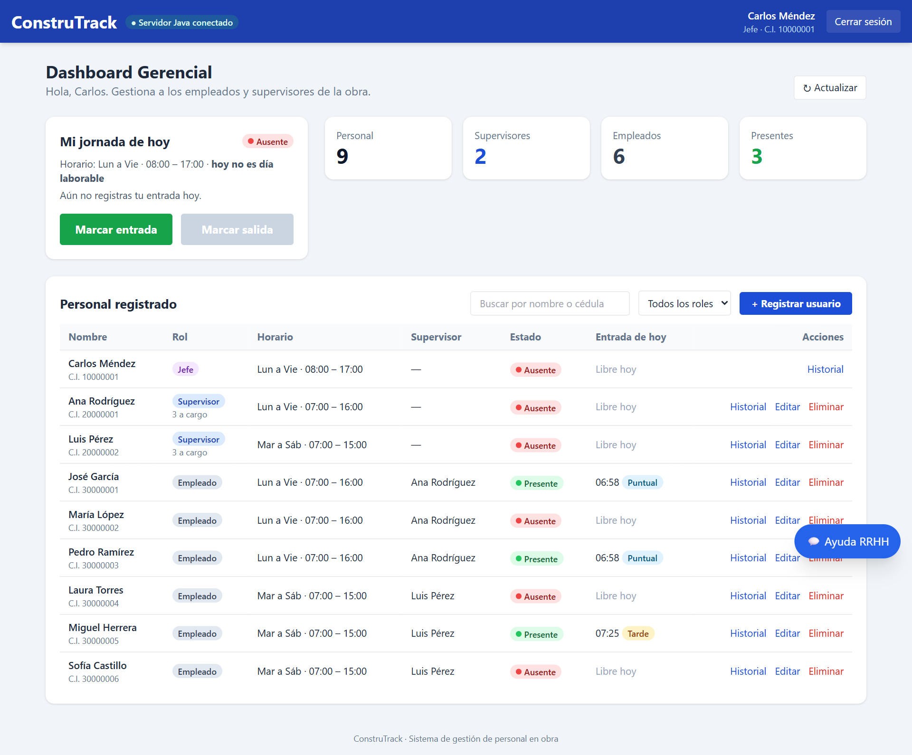
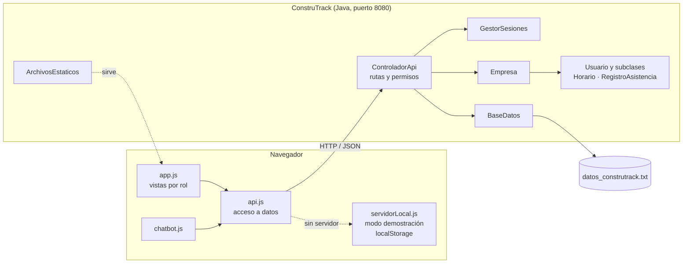
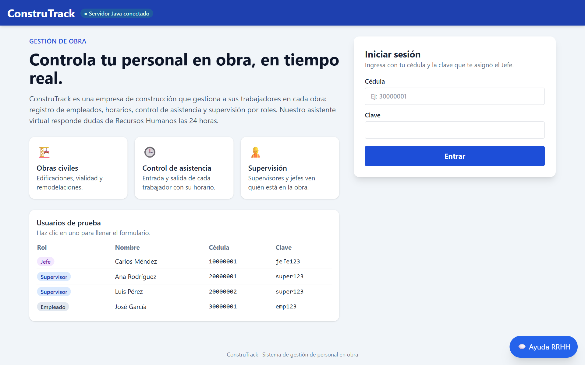
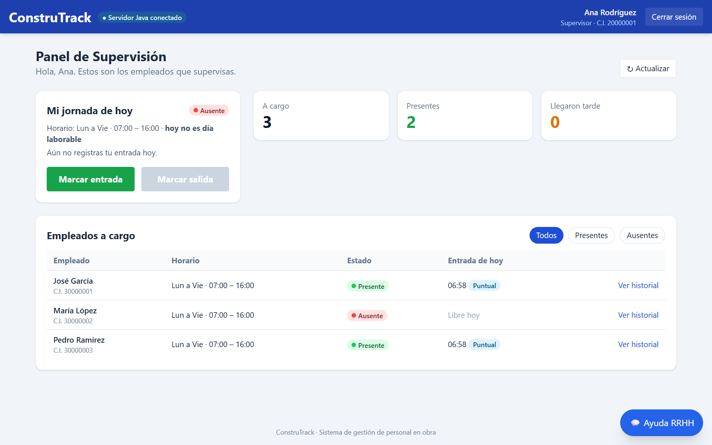
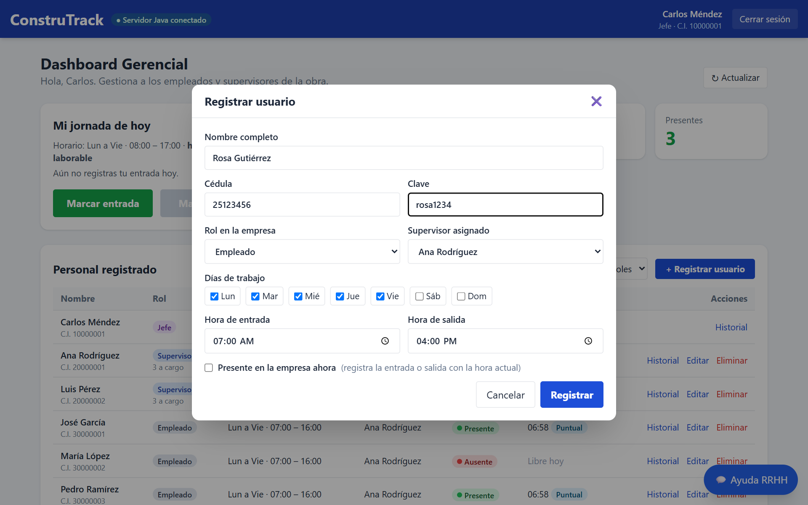
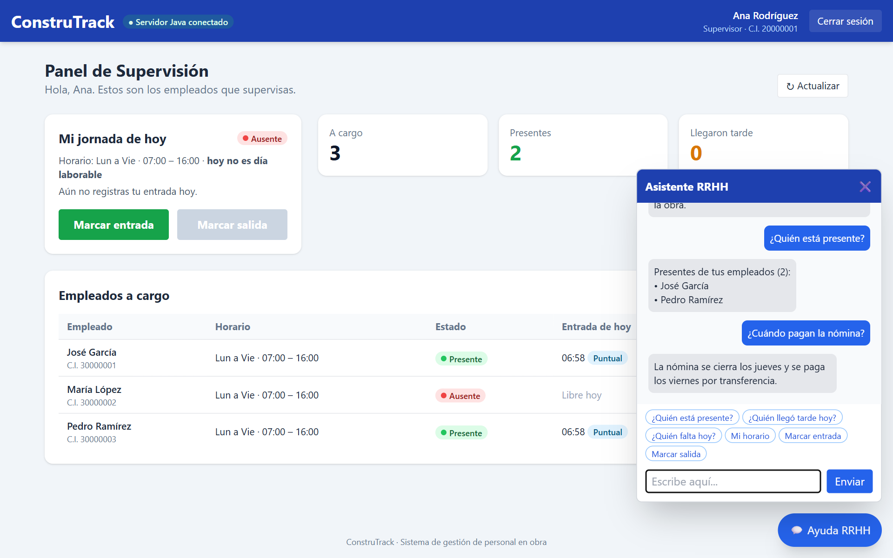

# ConstruTrack · Gestión de personal en obra

[](https://github.com/diavolo34/Proyecto-Poo/actions/workflows/ci.yml)


Sistema web para una empresa de construcción que **registra al personal de obra, controla su asistencia y ofrece un panel distinto para cada rol** (Empleado, Supervisor y Jefe), con un chatbot de Recursos Humanos integrado.

Proyecto de **Programación Orientada a Objetos** (Programación Orientada a Objetos, UCAB). El backend es un servidor HTTP escrito en **Java puro, sin librerías externas**, diseñado con herencia, polimorfismo, encapsulamiento y separación por capas.



---

## Contenido

- [Funcionalidades](#funcionalidades)
- [Arquitectura](#arquitectura)
- [Diseño orientado a objetos](#diseño-orientado-a-objetos)
- [Cómo ejecutarlo](#cómo-ejecutarlo)
- [API REST](#api-rest)
- [Estructura del repositorio](#estructura-del-repositorio)
- [Capturas](#capturas)
- [Hoja de ruta](#hoja-de-ruta)

## Funcionalidades

| Rol | Qué puede hacer |
|-----|-----------------|
| **Empleado** | Ver sus datos, horario e historial; marcar **entrada** y **salida** (se calcula la puntualidad con 10 min de tolerancia). |
| **Supervisor** | Todo lo anterior + supervisar a **sus** empleados: presencia, hora de entrada de hoy, puntualidad, filtros e historial. |
| **Jefe** | Administrar al personal: **registrar, editar, eliminar**, cambiar rol y horario, y asignar supervisor. |
| **Visitante** | Información de la empresa y chatbot «Ayuda RRHH». |

- **Permisos validados en el servidor**, no solo en la interfaz (`401`, `403`, `404`, `409`).
- **Chatbot contextual**: responde preguntas de nómina, permisos y horarios; con sesión iniciada responde según el rol («¿quién llegó tarde hoy?», «marcar entrada»…).
- **Persistencia** en archivo de texto (`datos_construtrack.txt`), con datos de prueba que se crean automáticamente.
- **Modo demostración**: sin el servidor Java (por ejemplo en GitHub Pages) la página reproduce en el navegador las mismas rutas y reglas del servidor.
- Interfaz **responsive** y en español.

## Arquitectura



| Capa | Clases |
|------|--------|
| Dominio | `Usuario` *(abstracta)*, `Empleado`, `Supervisor`, `Jefe`, `Horario`, `RegistroAsistencia`, `Empresa` |
| Aplicación / API | `ControladorApi`, `GestorSesiones` |
| Infraestructura | `ConstruTrack` (punto de entrada), `BaseDatos`, `Json`, `ArchivosEstaticos` |
| Presentación | `web/index.html`, `js/app.js`, `js/api.js`, `js/chatbot.js`, `js/servidorLocal.js` |

## Diseño orientado a objetos

<p align="center">
  
</p>

- **Herencia y polimorfismo**: `Usuario` es abstracta y cada subclase implementa `getRol()` y sus propias responsabilidades (`Supervisor.verEmpleadosACargo()`, `Jefe.registrarUsuario()`…).
- **Método fábrica**: `Usuario.crear(rol, …)` instancia la subclase correcta a partir del rol.
- **Composición**: `Horario` y `RegistroAsistencia` no existen sin su `Usuario`.
- **Agregación**: `Empresa` agrupa a los usuarios.
- **Encapsulamiento**: validación en los *setters* (cédula de 6 a 9 dígitos, horas válidas, etc.).

Todos los diagramas (casos de uso, clases y secuencia) están en [`docs/diagramas`](docs/diagramas), con su fuente PlantUML.

## Cómo ejecutarlo

### Requisitos

- JDK 21 o superior. El proyecto de NetBeans está configurado con la versión de JDK del IDE.
- Apache NetBeans (opcional).

### Con NetBeans

1. `File → Open Project…` y seleccionar la carpeta **`ConstruTrack`**.
2. Ejecutar con **Run** (`F6`).
3. Abrir **http://localhost:8080**.

### Desde la terminal

```bash
javac --release 17 -encoding UTF-8 -d out $(find ConstruTrack/src -name "*.java")
(cd ConstruTrack/src && find . -type f ! -name "*.java" -exec cp --parents {} ../../out/ \;)
java -cp out construtrack.App
```

### Usuarios de prueba

| Rol | Nombre | Cédula | Clave |
|-----|--------|--------|-------|
| Jefe | Carlos Méndez | `10000001` | `jefe123` |
| Supervisor | Ana Rodríguez | `20000001` | `super123` |
| Supervisor | Luis Pérez | `20000002` | `super123` |
| Empleado | José García (+5: `30000002`…`30000006`) | `30000001` | `emp123` |

> Para volver a los datos iniciales, borra `datos_construtrack.txt` y reinicia el servidor. En modo demostración usa el botón «Restablecer datos de prueba».

## API REST

| Método | Ruta | Acceso |
|--------|------|--------|
| `GET` | `/api/estado` | Público |
| `POST` | `/api/login` | Público |
| `POST` | `/api/logout` | Con sesión |
| `GET` | `/api/yo` | Con sesión |
| `POST` | `/api/asistencia/entrada` · `/api/asistencia/salida` | Con sesión |
| `GET` | `/api/usuarios` | Jefe (todos) · Supervisor (sus empleados) |
| `GET` | `/api/usuarios/{cedula}` | Jefe · Supervisor (sus empleados) · el propio usuario |
| `POST` `PUT` `DELETE` | `/api/usuarios[/{cedula}]` | Jefe |

Autenticación con cabecera `Authorization: Bearer <token>`. Las respuestas son JSON y los errores usan `{"error": "mensaje"}`.

## Estructura del repositorio

```
.
├── ConstruTrack/                 Proyecto NetBeans (Ant)
│   ├── src/construtrack/         Código Java (paquete construtrack)
│   │   └── web/                  Interfaz web servida por el servidor
│   ├── nbproject/  build.xml
│   └── README.md
├── docs/
│   ├── diagramas/                UML en PlantUML + SVG/PNG
│   ├── capturas/                 Capturas de la aplicación
│   └── prompts.md                Prompts de IA utilizados
├── tools/generador/              Scripts (Python + Playwright) del informe PDF
└── .github/workflows/            CI (compilación + prueba de API) y GitHub Pages
```

## Capturas

| Inicio | Supervisor |
|--------|------------|
|  |  |
| **Registro de usuario (Jefe)** | **Chatbot** |
|  |  |

## Hoja de ruta

- [x] **Entrega 1**: registro de usuarios, roles y permisos, asistencia, chatbot y diagramas UML.
- [ ] Próximas entregas: nuevos temas de la materia.

## Notas

- Proyecto académico: las claves se guardan en texto plano a propósito, para simplificar la demostración. En producción se usaría un *hash* con sal (por ejemplo, bcrypt).
- La documentación de la entrega incluye los prompts de IA usados ([`docs/prompts.md`](docs/prompts.md)), por transparencia.

## Autor

**Francisco Manzano** · [@diavolo34](https://github.com/diavolo34)
Universidad Católica Andrés Bello, Programación Orientada a Objetos
