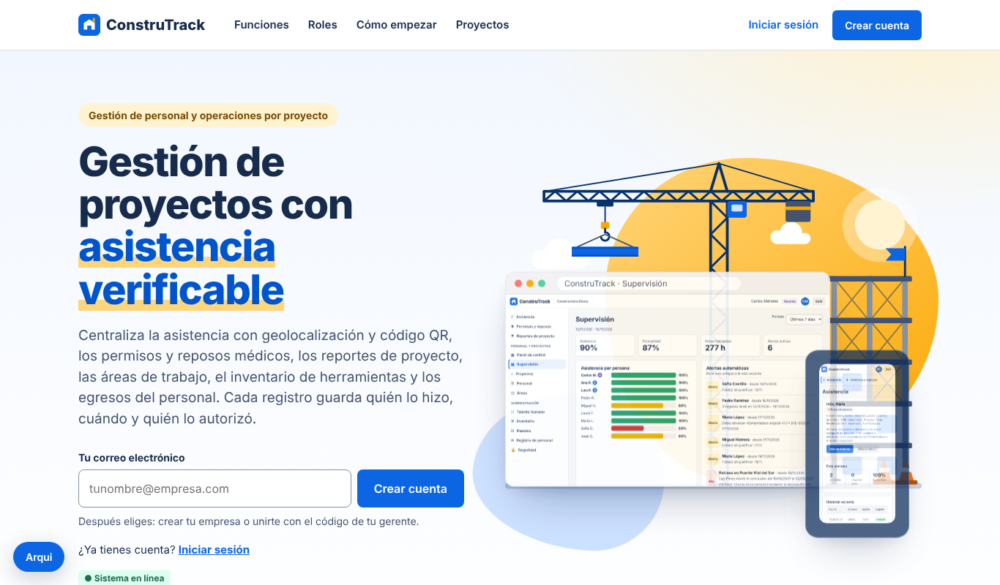
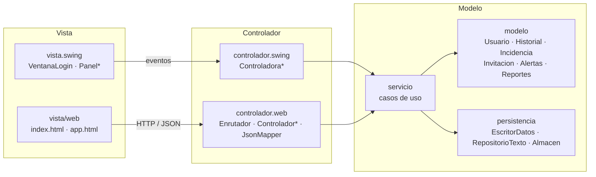
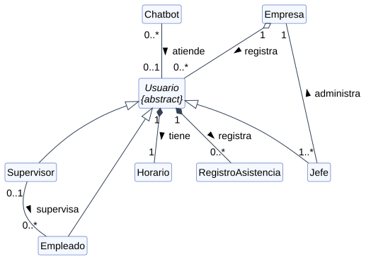
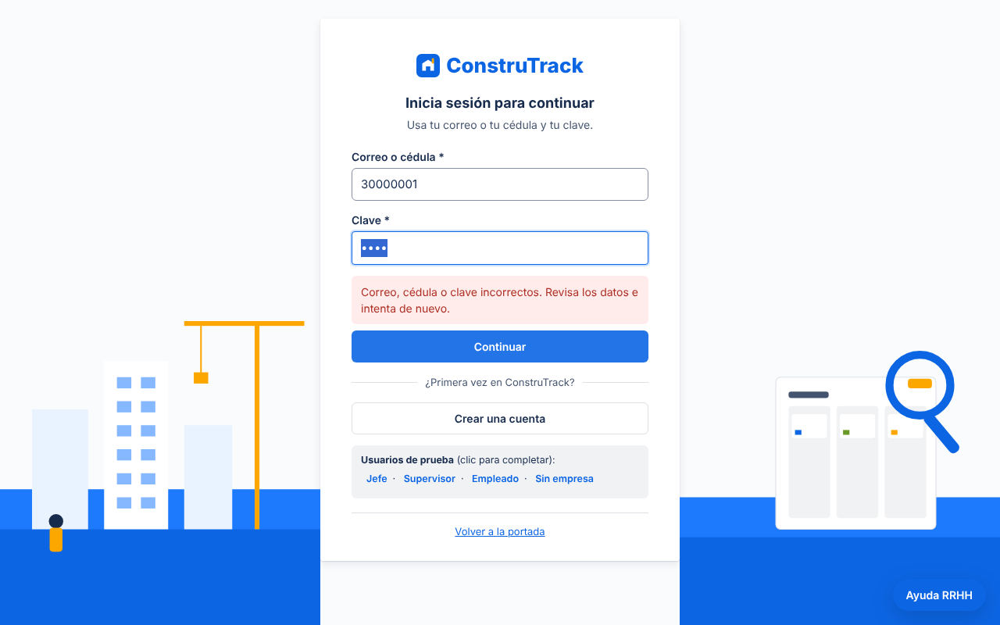
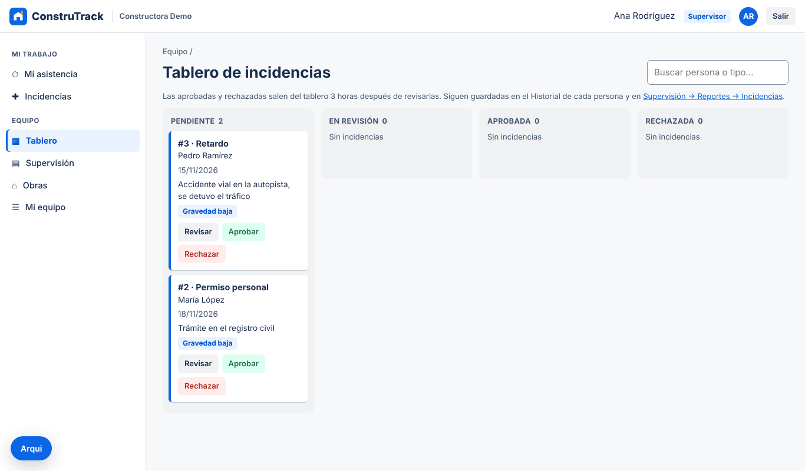
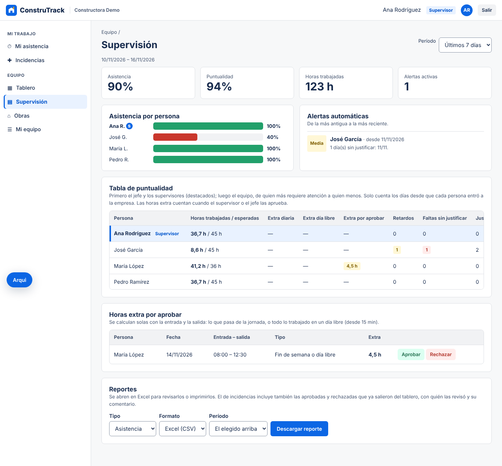
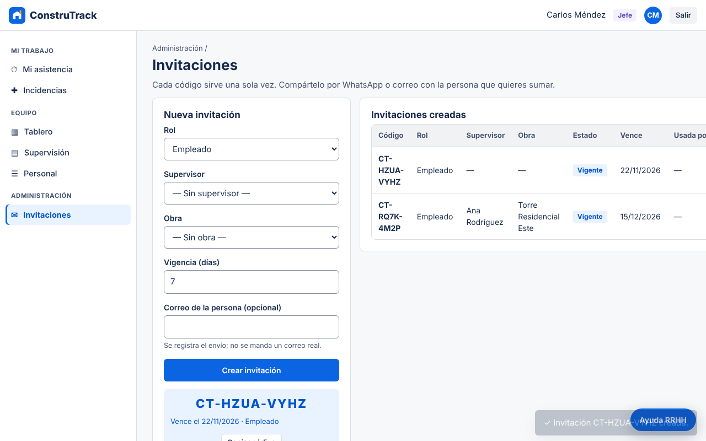
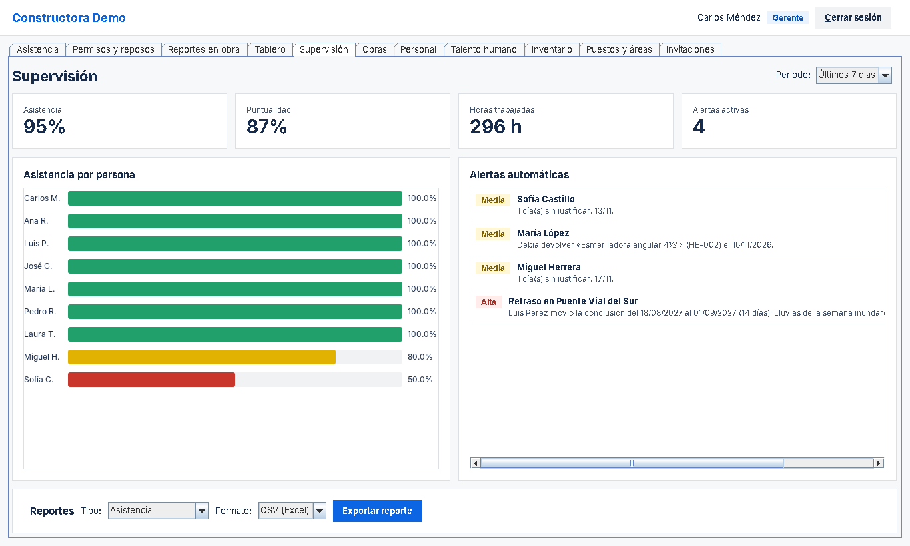
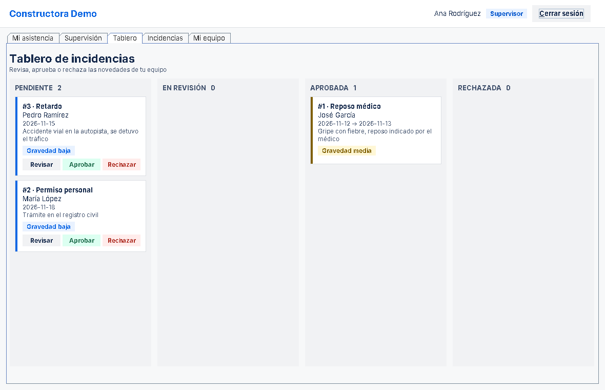

# ConstruTrack · Gestión de personal en obra

[](https://github.com/diavolo34/Proyecto-Poo/actions/workflows/ci.yml)


[](https://startling-toffee-914e34.netlify.app)

> **Pruébalo en línea:** https://startling-toffee-914e34.netlify.app (usuarios de prueba [más abajo](#usuarios-de-prueba)).
> El servidor usa el plan gratuito de Render: si nadie lo usó en un rato, la primera carga tarda unos 50 segundos.

Sistema para una empresa de construcción que **controla la asistencia del personal de obra, gestiona sus incidencias
(reposos médicos, permisos, retardos, accidentes) y apoya al supervisor con alertas automáticas, estadísticas y reportes**.
Tiene **dos vistas sobre el mismo modelo**: una aplicación de escritorio (Swing) y una aplicación web.

Proyecto de **Programación Orientada a Objetos** (UCAB). Backend en **Java puro, sin librerías externas**, diseñado con
herencia, polimorfismo, interfaces, composición y los principios **SOLID**, en una arquitectura **MVC por capas**.



## Contenido

- [Funcionalidades](#funcionalidades)
- [Arquitectura](#arquitectura)
- [Cómo ejecutarlo](#cómo-ejecutarlo)
- [Usuarios de prueba](#usuarios-de-prueba)
- [Capturas](#capturas)
- [Documentación](#documentación)
- [API REST](#api-rest)
- [Calidad](#calidad)

## Funcionalidades

| Rol | Qué puede hacer |
|-----|-----------------|
| **Visitante** | Ver la portada, consultar a **Arqui**, el asistente virtual, y **crear su cuenta** con correo, nombre, apellido, cédula o DNI y teléfono, eligiendo **«Soy jefe: crear mi empresa»** o **«Me uno a una empresa»**. |
| **Empleado** | Unirse a la empresa con un **código de invitación**, marcar entrada y salida (puntualidad con 10 min de tolerancia), ver su historial y **reportar incidencias**. |
| **Supervisor** | Todo lo anterior + **tablero Kanban** para aprobar o rechazar las incidencias de su equipo, **aprobar horas extra**, **alertas automáticas** (de la más antigua a la más reciente), **tabla de puntualidad** con horas trabajadas, **gestionar obras** y **reportes** en CSV o texto. |
| **Jefe** | **Crea su empresa** al registrarse. Todo lo anterior para toda su empresa + **gestionar al personal** y **crear invitaciones** de un solo uso con rol, supervisor y obra, que se **envían por correo**. |

Reglas destacadas:
- Un **reposo médico aprobado** justifica la falta; si está pendiente o rechazado, el día cuenta como ausencia.
- Las **alertas** se generan solas: 3 o más retardos en la semana, faltas sin justificar e incidencias sin resolver por más de 48 h.
- **Varias empresas**: cada jefe crea la suya y solo ve sus datos (personal, obras, incidencias, reportes). Los empleados y supervisores entran con el código que les da su jefe, y el código define su rol.
- Los **permisos se validan en el servidor**: un supervisor solo ve y revisa a su equipo.
- Las claves se guardan como **resumen SHA-256 con sal**, nunca en texto plano.
- Las **horas extra** se calculan solas (lo que pasa de la jornada o un día libre completo) y solo cuentan al aprobarse.
- El **Historial** de cada persona reúne su asistencia y sus incidencias; las faltas se cuentan desde su ingreso.
- La **cédula** nueva solo admite números; la hora es la de Venezuela aunque el servidor esté en UTC.

## Arquitectura



- **Modelo** sin dependencias de la vista: las dos interfaces reutilizan exactamente las mismas reglas. Ver [docs/diseno/mvc.md](docs/diseno/mvc.md).
- **SOLID** con ejemplos reales y su antes/después: [docs/diseno/solid.md](docs/diseno/solid.md).
- **UX/UI**: las 10 heurísticas de Nielsen, leyes de Hick, Gestalt y Von Restorff, y WCAG con contrastes medidos: [docs/diseno/ux-ui.md](docs/diseno/ux-ui.md).

<p align="center"></p>

## Cómo ejecutarlo

### Con NetBeans (recomendado)

1. `File → Open Project…` → carpeta **`ConstruTrack`**.
2. **Run** (F6): se abre la **ventana de escritorio** y el **servidor web** queda en http://localhost:8080
   (portada en `/`, sistema en `/app.html`). No hace falta internet.

Requisitos: JDK 17 o superior. Para correr las pruebas (*Test Project*), agrega la biblioteca JUnit 5 que trae NetBeans.

### Desde la terminal

```bash
javac --release 17 -encoding UTF-8 -d out $(find ConstruTrack/src -name "*.java")
(cd ConstruTrack/src && find . -type f ! -name "*.java" -exec cp --parents {} ../../out/ \;)
java -cp out construtrack.App            # servidor + ventana (usa --sin-ventana para solo el servidor)
```

### En internet

| Parte | Dirección |
|-------|-----------|
| Página web (Netlify) | https://startling-toffee-914e34.netlify.app |
| Servidor Java / API (Render) | https://construtrack-api.onrender.com/api/estado |

El servidor Java se publica en **Render** (`Dockerfile` + `render.yaml`) y se vuelve a desplegar solo con cada cambio en `main`.
La página se sirve desde **Netlify** (`netlify.toml`). Pasos en [docs/despliegue.md](docs/despliegue.md).

## Usuarios de prueba

| Rol | Correo | Cédula | Clave |
|-----|--------|--------|-------|
| Jefe | `carlos.mendez@construtrack.demo` | `10000001` | `jefe123` |
| Supervisora | `ana.rodriguez@construtrack.demo` | `20000001` | `super123` |
| Supervisor | `luis.perez@construtrack.demo` | `20000002` | `super123` |
| Empleado | `jose.garcia@construtrack.demo` (+5 más) | `30000001` … `30000006` | `emp123` |
| Registrada sin empresa | `rosa.gutierrez@correo.com` | — | `rosa1234` |

Código de invitación de prueba: **`CT-RQ7K-4M2P`** (Empleado, supervisora Ana, obra Torre Residencial Este).
Para volver a los datos iniciales, borra `datos_construtrack.txt` y reinicia.

## Capturas

| Inicio de sesión | Tablero de incidencias |
|---|---|
|  |  |
| **Supervisión: alertas y estadísticas** | **Invitaciones (Jefe)** |
|  |  |
| **Escritorio (Swing): supervisión** | **Escritorio (Swing): tablero** |
|  |  |

Más capturas en [docs/capturas](docs/capturas).

## Documentación

| Tema | Documento |
|------|-----------|
| Arquitectura MVC | [docs/diseno/mvc.md](docs/diseno/mvc.md) |
| Principios SOLID | [docs/diseno/solid.md](docs/diseno/solid.md) |
| Principios UX/UI | [docs/diseno/ux-ui.md](docs/diseno/ux-ui.md) |
| Diagramas UML (casos de uso, clases, paquetes, secuencia) | [docs/diagramas](docs/diagramas) |
| Scrum: backlog y sprints | [docs/scrum](docs/scrum) |
| Despliegue (Render + Netlify) | [docs/despliegue.md](docs/despliegue.md) |
| Herramienta de IA y prompts | [docs/prompts.md](docs/prompts.md) |

## API REST

Autenticación con la cabecera `Authorization: Bearer <token>`; respuestas en JSON y errores como `{"error": "mensaje"}`
con códigos 400, 401, 403, 404 o 409.

| Método | Ruta | Acceso |
|--------|------|--------|
| `GET` | `/api/estado` · `/api/publico` | Público |
| `POST` | `/api/login` (correo o cédula) · `/api/registro` | Público |
| `POST` | `/api/unirse` · `/api/empresas` (crear la empresa y quedar como Jefe) | Cuenta registrada |
| `POST` | `/api/logout` · `GET /api/yo` | Con sesión |
| `POST` | `/api/asistencia/entrada` · `/api/asistencia/salida` | Con sesión |
| `GET` `POST` | `/api/incidencias` · `GET /api/incidencias/opciones` | Con sesión (cada uno ve lo suyo o su equipo) |
| `PUT` | `/api/incidencias/{id}/revision` | Supervisor del afectado · Jefe |
| `GET` | `/api/estadisticas` · `/api/supervision/alertas` · `/api/reportes/{tipo}` | Supervisor (su equipo) · Jefe |
| `GET` `POST` `PUT` `DELETE` | `/api/usuarios[/{cedula}]` · `GET /api/personal/opciones` | Jefe (Supervisor: solo lectura de su equipo) |
| `GET` `PUT` | `/api/horas-extra` · `/api/horas-extra/{cedula}/{fecha}` | Supervisor (su equipo) · Jefe |
| `GET` `POST` `PUT` `DELETE` | `/api/obras[/{codigo}]` · `PUT /api/usuarios/{cedula}/obra` | Supervisor · Jefe |
| `GET` `POST` `DELETE` | `/api/invitaciones[/{codigo}]` · `POST /api/invitaciones/{codigo}/enviar` | Jefe |

## Calidad

- **CI en GitHub Actions:** compila con `-Xlint:all -Werror`, ejecuta las **40 pruebas JUnit 5** y una prueba de humo de la API.
- **Pruebas** del modelo, la persistencia y los servicios con reloj fijo; se comprobó que detectan errores introducidos a propósito.
- Verificado en la interfaz real: recorridos de la web con Playwright, de Swing en pantalla virtual, y despliegue con Docker y CORS.

## Estructura del repositorio

```
ConstruTrack/                 Proyecto NetBeans (Ant)
  src/construtrack/
    App.java                  Punto de entrada (composición de dependencias)
    modelo/                   Dominio: usuarios, historial, incidencias, alertas, reportes, excepciones
    servicio/                 Casos de uso
    persistencia/             Repositorios y datos de prueba
    controlador/swing|web/    Controladores de cada vista
    vista/swing/              Ventanas y paneles Swing
    vista/web/                Portada, aplicación web, CSS y JavaScript
  test/construtrack/          Pruebas JUnit 5
docs/                         Diseño, UML, Scrum, capturas, despliegue
tools/generador/              Genera el PDF de entrega
Dockerfile · render.yaml · netlify.toml
```

## Autor

**Francisco Manzano** · [@diavolo34](https://github.com/diavolo34) · Universidad Católica Andrés Bello · Programación Orientada a Objetos
