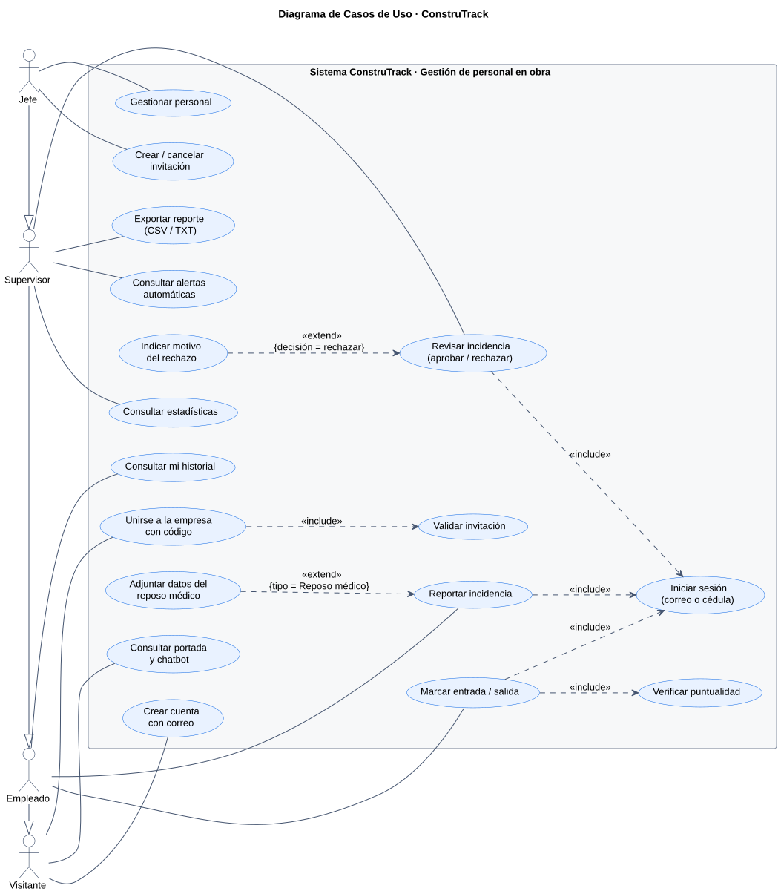
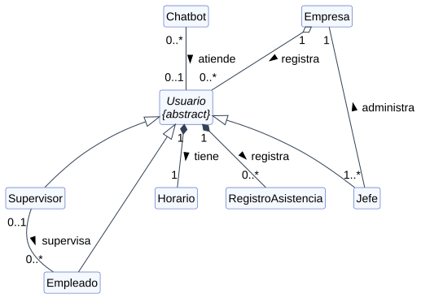
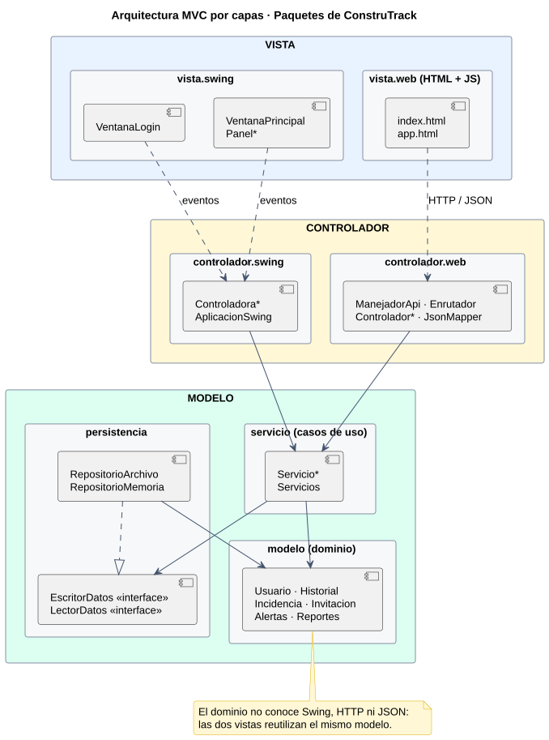

# Diagramas UML · ConstruTrack (entrega 2)

Fuentes en [PlantUML](https://plantuml.com/) (`*.puml`, con el estilo común `estilo.iuml`) y su render en `img/` (SVG y PNG).

> Según la corrección de la entrega 1, los **diagramas de secuencia usan solo objetos de clases del modelo**
> (las que aparecen en los diagramas de clases): no aparecen gestores, servicios, controladores ni la API.

## Casos de uso y clases

| # | Diagrama | Imagen |
|---|----------|--------|
| 1 | Casos de uso (actores con generalización, `<<include>>` y `<<extend>>` con su condición) |  |
| 2 | Clases · Modelo de dominio (solo nombres, relaciones, roles y cardinalidad) |  |
| 3 | Clases detallado 1/4 · Núcleo (usuarios, historial, cuentas, invitaciones) | [ver](img/clases_nucleo.svg) |
| 4 | Clases detallado 2/4 · Incidencias (herencia, interfaz `Justificable`, fábrica) | [ver](img/clases_incidencias.svg) |
| 5 | Clases detallado 3/4 · Alertas, estadísticas y reportes (OCP y Template Method) | [ver](img/clases_supervision.svg) |
| 6 | Paquetes · Arquitectura MVC |  |
| 7 | Clases detallado 4/4 · Servicios y persistencia (DIP) | [ver](img/clases_servicio_persistencia.svg) |

Notación del modelo detallado: `-` privado, `+` público, `#` protegido, `~` paquete; `{static}` subrayado y `{abstract}` en cursiva;
atributos como `nombre : Tipo [multiplicidad] = valorInicial` y métodos como `nombre(param : Tipo) : Retorno`.

## Secuencia (un caso de uso por diagrama, escenario positivo y negativo)

| # | Caso de uso | Imagen |
|---|-------------|--------|
| 8 | Marcar entrada | [ver](img/secuencia_marcar_entrada.svg) |
| 9 | Reportar incidencia (reposo médico) | [ver](img/secuencia_reportar_incidencia.svg) |
| 10 | Revisar incidencia (aprobar / rechazar) | [ver](img/secuencia_revisar_incidencia.svg) |
| 11 | Evaluar alertas automáticas | [ver](img/secuencia_evaluar_alertas.svg) |
| 12 | Generar reporte de asistencia en CSV | [ver](img/secuencia_generar_reporte.svg) |
| 13 | Unirse a la empresa con un código | [ver](img/secuencia_unirse_empresa.svg) |
| 14 | Un jefe se registra y crea su empresa | [ver](img/secuencia_crear_empresa.svg) |

## Regenerar las imágenes

```bash
# Requiere Java y Graphviz (dot); plantuml.jar se descarga de Maven Central
java -jar plantuml.jar -tsvg -o img -charset UTF-8 docs/diagramas/[0-9]*.puml
java -jar plantuml.jar -tpng -o img -charset UTF-8 docs/diagramas/[0-9]*.puml
```
