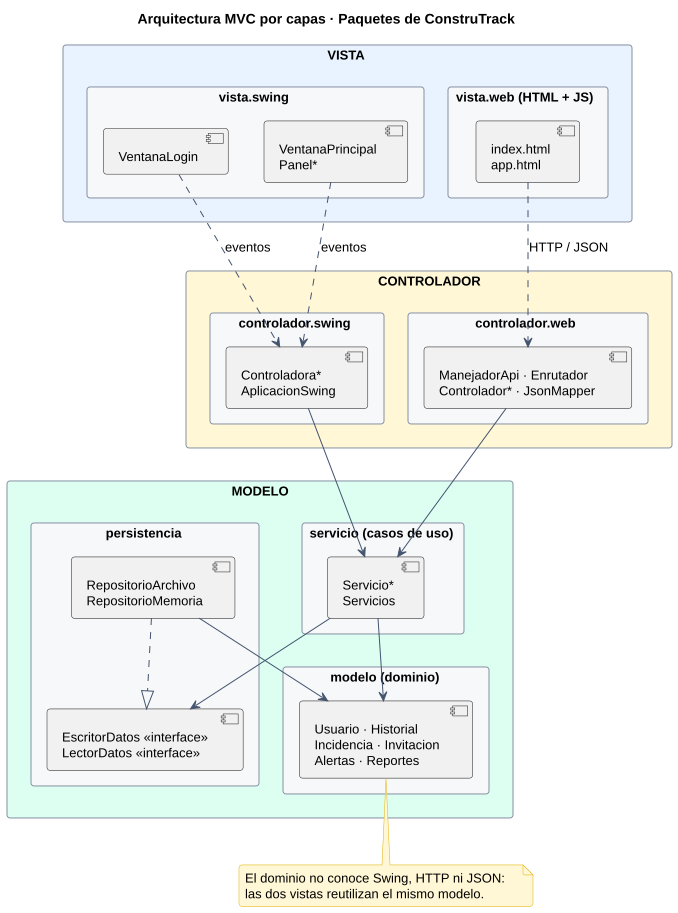

# Arquitectura MVC de ConstruTrack

ConstruTrack separa el sistema en **Modelo, Vista y Controlador**. La prueba de que la separación es real es que
**existen dos vistas distintas —escritorio (Swing) y web— que usan exactamente el mismo modelo y los mismos
servicios**, en el mismo proceso: lo que el Gerente aprueba en la ventana Swing aparece al instante en el navegador.



## Las capas

| Capa | Paquete | Responsabilidad | Ejemplos |
|------|---------|-----------------|----------|
| **Modelo · dominio** | `construtrack.modelo` (+ `novedades`, `talento`, `inventario`, `alertas`, `reportes`, `excepciones`) | Reglas del negocio. No conoce Swing, HTTP ni JSON. | `Plataforma`, `Empresa`, `Usuario`, `Historial`, `Novedad`, `Inventario`, `Egreso`, `MonitorSupervision` |
| **Modelo · casos de uso** | `construtrack.servicio` | Orquesta el dominio, aplica permisos, sincroniza y guarda. | `ServicioNovedades`, `ServicioTalento`, `ServicioInventario`, `ServicioSupervision` |
| **Modelo · persistencia** | `construtrack.persistencia` | Lee y escribe los datos detrás de interfaces. | `EscritorDatos`, `RepositorioTexto`, `Almacen` |
| **Controlador** (escritorio) | `construtrack.controlador.swing` | Recibe la vista, registra sus eventos y llama a los servicios. | `ControladoraNovedades`, `ControladoraTablero`, `ControladoraInventario` |
| **Controlador** (web) | `construtrack.controlador.web` | Traduce peticiones HTTP en llamadas a servicios y respuestas JSON. | `Enrutador`, `ControladorNovedades`, `JsonMapper` |
| **Vista** (escritorio) | `construtrack.vista.swing` | Construye y expone los componentes; sin lógica de negocio. | `VentanaLogin`, `PanelTablero`, `Tema` |
| **Vista** (web) | `construtrack/vista/web` | HTML, CSS y JavaScript que consumen la API. | `index.html`, `app.html`, `js/vistas.js` |

## Cómo fluye una acción (el gerente aprueba un reposo médico)

```
[Vista]        PanelTablero: el gerente pulsa «Aprobar» y escribe la nota
                   │ evento (ActionListener)
[Controlador]  ControladoraTablero.accion(...) → novedades.revisar(usuario, id, APROBADA, nota)
                   │
[Modelo]       ServicioNovedades.revisar → Gerente.revisar → Novedad.revisar (exige la nota y deja la Firma del gerente)
                   │ guarda con EscritorDatos
[Controlador]  alCambiar.run() → cada controladora vuelve a pedir datos al modelo
[Vista]        las tarjetas se redibujan en su nueva columna
```

En la web el recorrido es el mismo, cambiando solo los extremos: `js/novedades.js` → `PUT /api/novedades/{id}/revision`
→ `ControladorNovedades` → **el mismo** `ServicioNovedades.revisar`.

## El patrón de la materia: Vista → Controladora

Siguiendo el ejemplo `VentanaCombo` / `Controladora` visto en clase, cada pantalla Swing tiene su controladora,
que **recibe la vista por constructor** y maneja su comportamiento:

```java
// controlador/swing/ControladoraNovedades.java
public ControladoraNovedades(PanelNovedades vista, ServicioNovedades novedades, ServicioArchivos archivos, Usuario usuario,
        Categoria categoria, Runnable alCambiar) {
    this.vista = vista;
    ...
    llenarCombos();                                                   // como llenar_combo() del ejemplo
    vista.getCboTipo().addActionListener(e -> mostrarCamposDelTipo()); // combo dependiente
    vista.getBtnRegistrar().addActionListener(e -> registrar());
}
```

La vista (`PanelNovedades`) solo crea los componentes y ofrece *getters*; nunca valida fechas ni decide permisos.

## Por qué sirve

- **Independencia:** se reescribió por completo la vista web (Sprint 5) sin tocar una línea del modelo.
- **Reutilización:** las reglas (por ejemplo, «solo el supervisor del empleado puede aprobar») están una sola vez,
  en `Supervisor.puedeRevisar`, y las dos vistas las respetan.
- **Pruebas:** el modelo y los servicios se prueban sin interfaz gráfica (`ConstruTrack/test`, 50 pruebas JUnit).

## Varias empresas en el mismo modelo

`Plataforma` es la raíz del modelo: agrupa las empresas y las cuentas personales (una cuenta existe antes de pertenecer
a una empresa). Un gerente crea su empresa al registrarse (`Plataforma.fundarEmpresa`) y sus empleados se unen con un
código. El aislamiento se garantiza en dos capas:

- **Servicios:** toda consulta o cambio se hace dentro de `empresaDe(actual)`: un gerente nunca recibe personas, obras,
  permisos, reportes o inventario de otra empresa; una cédula de otra empresa simplemente «no existe».
- **Modelo:** los permisos del Gerente (`puedeRevisar`, `puedeAprobarHorasDe`, `puedeAsignarObraA`, `puedeReportarPara`)
  exigen además `mismaEmpresaQue(otro)`, por si algún día otro controlador llamara al modelo directamente.

Ver la secuencia [Un gerente se registra y crea su empresa](../diagramas/img/secuencia_crear_empresa.svg).

