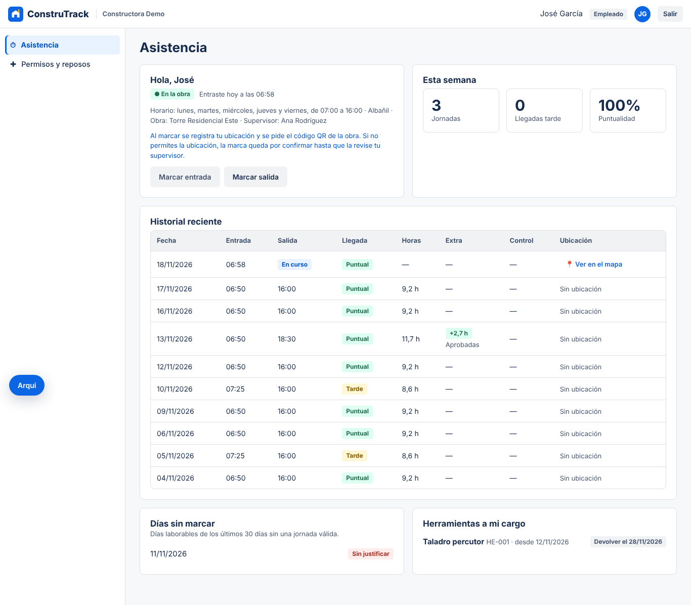
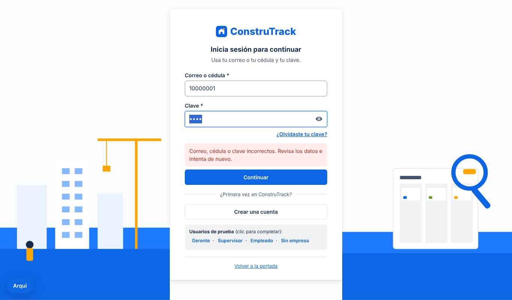
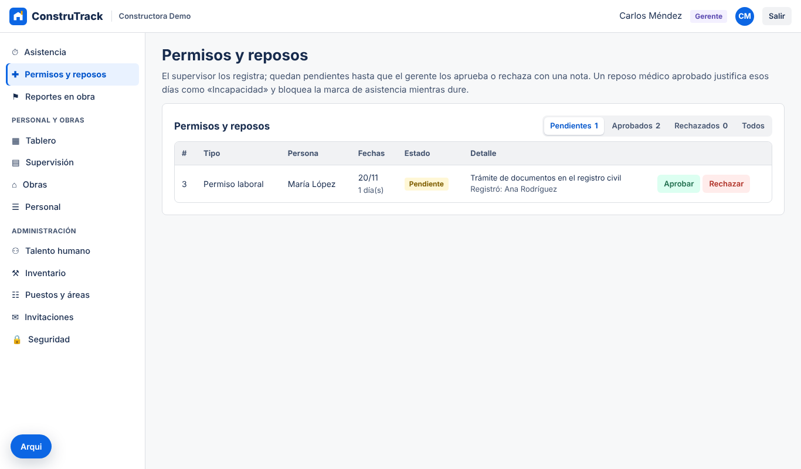
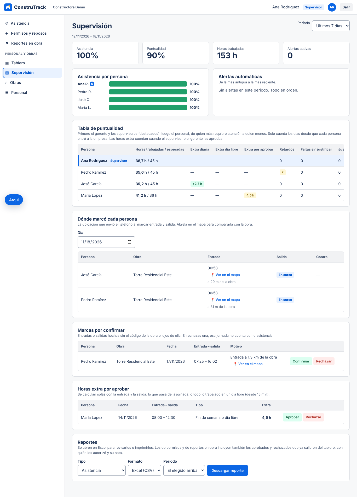
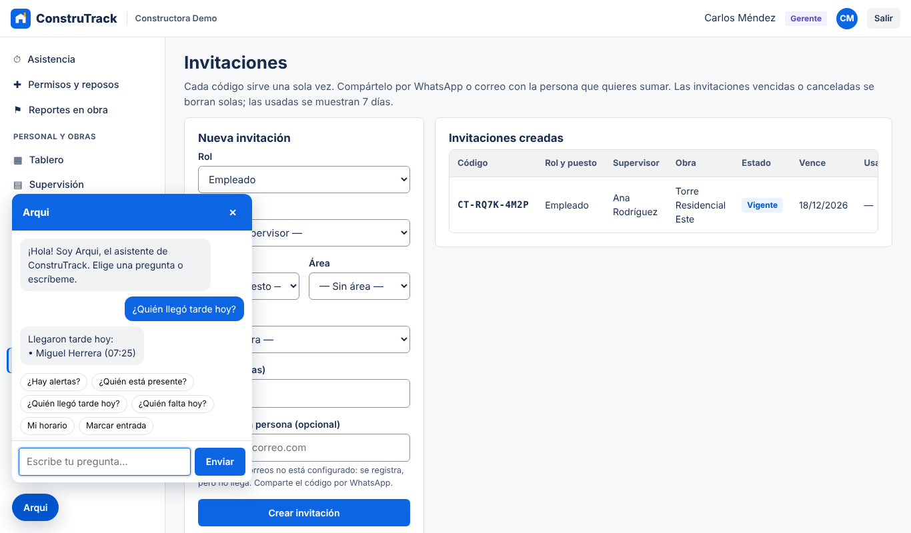
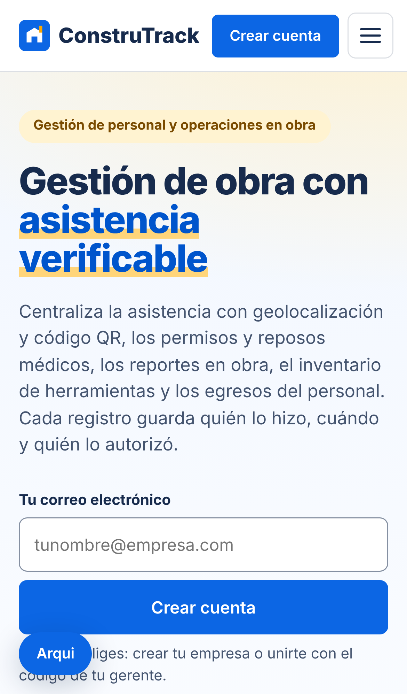

# Principios UX/UI aplicados en ConstruTrack

Este documento explica **por qué** creemos que ConstruTrack aplica los principios de UX/UI vistos en la materia.
Cada punto señala la pantalla concreta (con captura) y el archivo donde está implementado. Las dos vistas
—web y escritorio (Swing)— comparten la misma paleta y los mismos componentes (`vista/web/css/estilos.css` y
`vista/swing/Tema.java`), así que lo que se explica aquí vale para ambas.

**UX** (la estructura y el recorrido): cada rol ve solo lo que necesita, el registro guía paso a paso y los errores
dicen qué hacer. **UI** (la capa visual): tipografía, color, tarjetas y microinteracciones consistentes.

---

## 1. Las 10 heurísticas de usabilidad de Nielsen

### 1. Visibilidad del estado del sistema
El usuario siempre sabe qué está pasando:
- La barra superior muestra **quién inició sesión y con qué rol** (avatar + etiqueta).
- En «Asistencia», la etiqueta **● En la obra / ○ Fuera de la obra** y la hora de entrada de hoy.
- Si el servidor tarda (Render gratuito «despierta» en ~1 min), la página muestra **«Conectando con el servidor… N s»**
  con un indicador giratorio, en lugar de quedarse en blanco o simular datos (`js/app.js`).
- Cada acción confirma con un aviso breve: «✓ Reposo médico #6 registrado. Queda pendiente hasta que lo apruebe el gerente».

### 2. Coincidencia entre el sistema y el mundo real
Se usa el idioma de una obra de construcción, sin jerga técnica: «Marcar entrada», «Reposo médico», «Obra»,
«Supervisor», «Llegada tarde (25 min)». Las fechas se muestran como `15/11/2026` y los días como «lunes a viernes».
El tablero imita la pizarra con columnas que se usa en las obras (Pendiente → En revisión → Aprobada / Rechazada).

### 3. Control y libertad del usuario
- Todo modal se cierra con **Esc**, con **✕** o haciendo clic fuera (`js/ui.js → Modal`).
- Eliminar a una persona y cancelar una invitación **piden confirmación**.
- Aprobar o rechazar abre un cuadro para la nota que se puede **cancelar** sin cambiar nada.
- «Más tarde» en la pantalla de unirse y «Volver a la portada» en el acceso: siempre hay salida.

### 4. Consistencia y estándares
- Un solo sistema de diseño: los mismos colores, botones (primario azul, secundario gris, peligro rojo) y etiquetas en
  web y Swing.
- El logo siempre arriba a la izquierda y la sesión arriba a la derecha (ley de Jakob: como en Jira, Gmail, etc.).
- El acceso sigue el patrón de tarjeta centrada de los inicios de sesión conocidos.

### 5. Prevención de errores
- **Listas desplegables y casillas** en lugar de texto libre: tipo de permiso o reporte, persona, puesto, área, horas (cada 30 min),
  días de trabajo, supervisor y obra.
- El botón «Marcar entrada» se **deshabilita** cuando la persona ya está en la obra (y «Marcar salida» cuando no lo está).
- Campos de fecha nativos (`type="date"`), y el campo «Hasta» es opcional.
- El código de invitación usa un alfabeto **sin caracteres que se confunden** (sin 0/O ni 1/I/L) y acepta minúsculas y
  espacios (`CodigoInvitacion`).
- Las reglas se validan también en el servidor: nadie puede saltarse un permiso manipulando la página.

### 6. Reconocer antes que recordar
- Usuarios de prueba con **un clic** en el inicio de sesión.
- El chatbot muestra **preguntas sugeridas** según el rol.
- El formulario de permisos y reportes muestra **solo los campos del tipo elegido** (médico, matrícula y documento para reposos, minutos para
  retardos, lugar para accidentes), como el ejemplo de combos dependientes de la clase.
- El menú lateral está siempre visible y marca la sección actual.

### 7. Flexibilidad y eficiencia de uso
- **Enter** envía formularios; **Tab** recorre todo; atajos con Alt en Swing (Alt+I «Iniciar sesión», Alt+E «Marcar
  entrada», Alt+S «Marcar salida»).
- Búsqueda en vivo en el tablero y en Personal.
- El chatbot permite marcar la entrada escribiendo «ya llegué».
- Iniciar sesión con **correo o cédula**, lo que cada persona recuerde.

### 8. Diseño estético y minimalista
- Cada rol ve solo sus vistas: el Empleado tiene 2, el Supervisor 5 y el Gerente 6 (ley de Hick: menos opciones, decisiones más rápidas).
- Tarjetas con mucho espacio en blanco, una sola acción principal por pantalla y cifras grandes en Supervisión.

### 9. Ayudar a reconocer, diagnosticar y recuperarse de errores
Los mensajes dicen **qué pasó y qué hacer**, en español y sin códigos técnicos:

| Situación | Mensaje |
|-----------|---------|
| Clave incorrecta | «Correo, cédula o clave incorrectos. Revisa los datos e intenta de nuevo.» |
| Código usado | «Esta invitación está usada. Pide a tu gerente un código nuevo.» |
| Rechazo sin motivo | «Indica el motivo del rechazo para que el trabajador lo sepa.» |
| Puerto ocupado (NetBeans) | «El puerto 8080 ya está en uso. ¿Tienes ConstruTrack abierto en otra ventana?…» |

Los errores se muestran con texto rojo **y** con la palabra «Error:» o el ícono ⚠ (no dependen solo del color).

### 10. Ayuda y documentación
- Textos de ayuda debajo de cada campo («Sin puntos ni guiones», «Vacío = un día»).
- *Tooltips* en Swing.
- **Arqui**, el asistente virtual, en todas las pantallas, con respuestas sobre registro, códigos, roles, permisos y seguridad. Está abajo a la izquierda para no tapar los botones de acción, que en las tablas quedan a la derecha.

---

## 2. Psicología cognitiva aplicada a la UI

| Ley o efecto | Dónde se aplica |
|--------------|-----------------|
| **Ley de Hick:** más opciones, más tiempo para decidir | El menú se reduce según el rol; el formulario de permisos oculta los campos que no aplican; la portada tiene una sola acción principal («Crear cuenta»). |
| **Continuidad (Gestalt):** el ojo sigue un flujo | Las columnas del tablero se leen de izquierda a derecha en el orden del ciclo de vida; los 3 pasos de «Cómo funciona» están numerados en línea. |
| **Proximidad (Gestalt)** | Cada grupo de información va en su tarjeta: estado de hoy, resumen de la semana, historial. |
| **Efecto Von Restorff:** lo distinto se recuerda | El único botón azul de cada pantalla es la acción principal («Marcar entrada», «Crear cuenta»); las demás son grises. El código de invitación creado aparece grande sobre fondo azul. |
| **Estética y usabilidad:** lo atractivo se percibe más usable | Ilustraciones propias (Java2D y SVG), bloques de color en la portada y tarjetas con sombra suave. |
| **Percepción, atención y memoria** | Layout de barra superior + menú lateral (percepción), navegación siempre visible (atención) y colores constantes por significado: verde = bien, ámbar = atención, rojo = problema (memoria). |

## 3. Microinteracciones

Siguen el ciclo **disparador → regla → respuesta → bucle** visto en clase:

- Botones que cambian de color al pasar el ratón y se «hunden» al pulsarlos (CSS y `Tema.boton` en Swing).
- Tres puntos **«escribiendo…»** mientras el chatbot prepara la respuesta.
- Avisos flotantes que aparecen con una animación corta y desaparecen solos.
- Las barras de asistencia se animan al cargar.
- Todo respeta la preferencia del sistema «reducir movimiento» (`prefers-reduced-motion`).

## 4. Accesibilidad (WCAG)

| Punto del checklist | Cómo se cumple |
|---------------------|----------------|
| **Contraste mínimo 4.5:1** | Medido con la fórmula de WCAG para cada combinación usada (tabla abajo). |
| **Texto alternativo** | Las ilustraciones decorativas llevan `aria-hidden`; las barras de progreso tienen `aria-label` con su valor; en Swing el gráfico expone su descripción textual. |
| **Navegación por teclado** | Todo funciona con Tab y Enter; foco visible (contorno azul de 3 px); enlace «Saltar al contenido». |
| **No depender solo del color** | Estados con texto (`● En la obra`, «Incapacidad», «Vencida», «Error:») además del color. |
| **Etiquetas en formularios** | Cada campo tiene su `<label for>` (en Swing, `setLabelFor`); avisos con `role="alert"` / `aria-live`. |
| **Adaptable** | Funciona en celular sin desplazamiento horizontal (verificado a 390 px de ancho). |

Contrastes medidos:

| Combinación | Colores | Contraste |
|-------------|---------|-----------|
| Texto principal sobre blanco | `#172b4d` / `#ffffff` | 14.1:1 |
| Texto secundario sobre blanco | `#44546f` / `#ffffff` | 7.7:1 |
| Texto secundario sobre el fondo | `#44546f` / `#f7f8f9` | 7.2:1 |
| Botón primario (blanco sobre azul) | `#ffffff` / `#0c66e4` | 5.2:1 |
| Enlace azul sobre blanco | `#0c66e4` / `#ffffff` | 5.2:1 |
| Etiqueta verde | `#216e4e` / `#dcfff1` | 5.8:1 |
| Etiqueta amarilla | `#7f5f01` / `#fff7d6` | 5.5:1 |
| Etiqueta roja / errores | `#ae2e24` / `#ffeceb` | 5.7:1 |
| Etiqueta azul | `#0055cc` / `#e9f2ff` | 5.9:1 |
| Etiqueta morada | `#5e4db2` / `#f3f0ff` | 5.9:1 |
| Texto sobre gris suave | `#172b4d` / `#f1f2f4` | 12.6:1 |
| Borde de campo (componente, mínimo 3:1) | `#8590a2` / `#ffffff` | 3.2:1 |

## 5. UX en un entorno ágil

El proyecto se trabajó en sprints (ver `docs/scrum`). Para no acumular **deuda UX** («papercut bugs»), cada sprint terminó
revisando capturas reales de todas las pantallas, y se corrigió lo encontrado antes de cerrar. Algunos ejemplos:
formulario desbordado en el login de Swing, botón «Rechazar» cortado en el tablero, encabezado desbordado en el
celular y un mensaje engañoso («tu sesión expiró») para quien aún no se unía a la empresa.
Es una versión simple del *Dual-Track Agile*: diseñar y validar (capturas, recorridos) en paralelo a construir.
